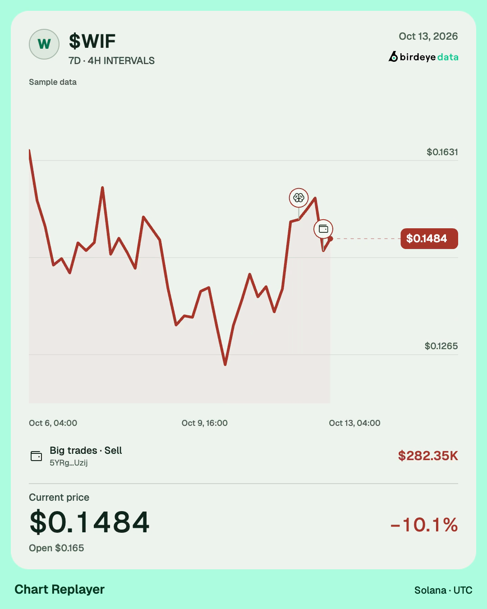

# Chart Replayer

**Replay any Solana token's chart over any window, with big trades, smart
money, KOLs, snipers and the dev marked where they traded, and export it as a
shareable video.** It is built entirely on the
[Birdeye Data API](https://data.birdeye.so). Candles, wallet-tag flows,
large swaps and wallet names all come from one provider, and videos render in
the browser with no server.

[](https://github.com/Hoanghai610/chart-replayer/actions/workflows/ci.yml)
[](./LICENSE)


[](https://vercel.com/new/clone?repository-url=https%3A%2F%2Fgithub.com%2FHoanghai610%2Fchart-replayer&project-name=chart-replayer&repository-name=chart-replayer)

| Light · Line (4:5) | Dark · Line (16:9) |
|---|---|
|  |  |

<sub>Frames from the built-in sample dataset (synthetic chart and tags).</sub>

## What it does

1. **Pick the window.** The token's whole history appears as a small chart
   with a window over it. Drag the handles to resize, drag inside to move,
   drag on empty chart to draw a new window, or use the arrow keys. Presets
   cover the common questions: full history, launch day, last 24h, 7D, 30D
   and the run from the low to the all-time high. Exact UTC times can be typed.
2. **Choose the candles.** The timeframe (1m to 1W) is picked to fit about 14
   candles per second of clip, so every candle stays on screen long enough to
   read; any timeframe that gives 3 to 8,000 candles can be forced.
3. **Add tags.** Each layer can be switched on or off:

   | Layer | Marker | Source |
   |---|---|---|
   | 🐋 Big trades | One swap at or above your size (Auto picks one) | Trades - Token Filtered By Volume |
   | 🧠 Smart money | Net buy or sell flow of smart traders in a bucket | Token - Wallet Tags Tracker |
   | 🎤 KOLs | Net flow of KOL wallets, named when Birdeye knows them | Wallet Tags Tracker + Details + Wallet Identity |
   | 🎯 Snipers | Net flow of wallets that bought in the first 5 blocks | Wallet Tags Tracker |
   | 🛠️ Dev | Net flow of the token's creator wallet | Wallet Tags Tracker |

   A density control keeps each layer's biggest markers (6, 14 or 60). The
   exact rules are in [docs/TAGS.md](./docs/TAGS.md).
4. **Replay and export.** Choose Line or Candles in Format. Both reveal the selected window, with a
   live value badge and at most three recent Phosphor trade pins. A reserved
   callout shows one important trade at a time; it never covers the chart.
   A compact result row shows current/close value, percentage change and open
   value throughout the clip. The final frame holds in place instead of
   switching to a full-screen result overlay. Export MP4 or WebM in 4:5,
   16:9, 9:16 or 1:1 at 1080p, 30 or 60 fps, with sound, rendered in the
   browser. The Export dialog shows progress and cancellation, then lets
   you preview and save the finished clip.

## Studio design

The approved direction adapts the ElevenLabs editor layout from
[Mobbin](https://mobbin.com/screens/1303bc7c-b188-49c2-9aa2-311fed674ee3):
a compact tool rail, one settings panel, a large video preview and a persistent
history timeline. Window, Tags, Format and Effects group the editing controls.
On phones, the tools move to a sticky horizontal bar; selecting a tool scrolls
to its settings, with a link back to the preview.

The UI uses the supplied Beside Core UI Kit v1.1 control conventions, with the
updated Birdeye green scale (#00FFA3 primary) and light/dark themes.
`src/lib/design-system.ts` is the shared palette for
CSS and the video renderer; `src/app/globals.css` defines semantic roles, control
sizes, radii and responsive layout. Aeonik is used when installed locally; the
bundled Geist font provides the default fallback. No licensed Aeonik font is
redistributed. The exported canvas has a soft brand outer frame: mint 200 in Light, green 950 in Dark. The Dark card uses near-black green charcoal and mint 300 accents.
Choose a separate Light or Dark video theme in Format; chart, text, icons and
the official Birdeye logo adapt to the selected theme in preview and export.
The video layout follows the supplied 4:5 reference: header, line chart,
reserved trade caption, compact current/close price with inline change and footer. Candles use the source
OHLC values; an unfinished candle reveals only its developing open/close range.
Exported icons are
actual Phosphor SVG assets; regenerate them with
`node --import tsx scripts/generate-video-icons.mjs`.

The approved Mindtrip start screen shows one centered token form and a sample link; tools, timeline and export appear only after a token loads. The approved Sound C (Glass & Air) is the default: sparse sweeps for important trades and one end chime, with no ticks or voice. Effects includes a sound preview button. References remain at `/review.html`.
Layout 1 and Sound C are approved and active. The feature inventory is in `docs/FEATURE_REVIEW.vi.md`.

## Quick start

Requires Node.js 20.9 or newer. A Birdeye Data API key is needed for real token data; the built-in sample works without one.

```bash
git clone https://github.com/Hoanghai610/chart-replayer.git
cd chart-replayer
cp .env.example .env.local   # then set BIRDEYE_API_KEY
npm install
npm run dev
```

Open http://localhost:3000 and paste a Solana token mint. No key yet? Click
**Try a sample replay** for a clearly labelled synthetic chart and tags.
Links share: the address bar keeps `?mint=…&from=…&to=…`.

## Bring your own key

Visitors can paste their own Birdeye Data API key in the app, so a public
deployment does not have to spend its own compute units.

- The key is kept in the tab's memory only: no localStorage, cookies or URLs.
- It travels to this app's API routes in an `x-birdeye-api-key` header, and
  from there to Birdeye. It is never logged.
- A visitor's key takes precedence over the server's `BIRDEYE_API_KEY`. With
  no server key, the app asks visitors for theirs.
- Cached responses are partitioned per key.

## Deploy to Vercel

Use the button above, or from the CLI:

```bash
vercel link
vercel deploy --prod
# optional: let the app pay for visitors who bring no key
vercel env add BIRDEYE_API_KEY production
```

Video rendering runs in the visitor's browser (WebCodecs + Mediabunny), so a
Hobby project is enough. Set `SITE_PASSWORD` to put a public link behind HTTP
Basic auth; the per-IP limit `RATE_LIMIT_PER_MINUTE` is on by default.

## Configuration

| Variable | Default | Purpose |
|---|---|---|
| `BIRDEYE_API_KEY` | unset | Server key, used when a visitor brings none |
| `SITE_PASSWORD` | unset | Site-wide Basic-auth password; unset means open |
| `RATE_LIMIT_PER_MINUTE` | `20` | Per-IP requests to token and tags (×3 for candles); `0` disables |
| `BIRDEYE_CONCURRENCY` | `12` | Parallel Birdeye requests per process |
| `CACHE_TTL_SECONDS` | `300` | In-process cache for responses, charts and tag layers |

## Birdeye Data endpoints and cost

| Endpoint | Used for | CU |
|---|---|---|
| `/defi/v3/ohlcv` | History overview and replay candles, 1m to 1W | 25–100 |
| `/defi/v3/token/meta-data/single`, `/defi/price` | Name, logo, spot price | 3 |
| `/defi/v3/token/market-data` | Circulating supply (market-cap axis), holders | 10 |
| `/token/v1/wallet-tags-tracker` | Smart money, KOL, sniper and dev flow per bucket | 30 per 50 buckets |
| `/token/v1/wallet-tags-tracker/details` | The KOL wallets behind each KOL bucket | 30 |
| `/defi/v3/token/txs-by-volume` | Big trades | 80 per 200 swaps |
| `/identity/v1/single` | Names for KOLs and the biggest traders | 30 each, up to 10 |

Backtested on 2026-10-09 with `npm run backtest` against a top memecoin, a
large token Birdeye skips for wallet tags, a month-old launch, a mid-cap,
USDC and a wallet address pasted by mistake, over six windows each (288
checks, all passing; the wallet address is refused as having no trading
history). A token costs about 60 CU to load, and a window with every layer
and names on costs 80–630 CU and 1–12 s. The app prints each request's CU in the **About data and API usage**
dialog, available from the information icon in the tool rail.

## Limits worth knowing

- **Wallet tags are Solana-only and skip some tokens.** Birdeye does not
  track them for core and very large tokens (SOL, USDC, USDT, BONK); the app
  says so and still shows big trades.
- **Tracker range limits.** A request may span 30 days of second buckets, 60
  of minute buckets, 90 of hour buckets and 365 of day or week buckets. Longer
  windows are split into several requests automatically.
- **Big trades top out at 200 swaps per window.** Auto raises the size until
  the window fits; when it cannot, the editor says so. Round trips (one
  wallet buying and selling the same size within two minutes, as arbitrage
  bots do) are hidden and counted.
- **Market cap** is price × today's circulating supply, so it is approximate
  for tokens whose supply changed.

## Project structure

```text
chart-replayer/
├── src/
│   ├── app/                     Next.js App Router
│   │   ├── page.tsx             studio entry
│   │   └── api/                 token · ohlcv · tags · health (server-only)
│   ├── components/
│   │   ├── studio.tsx           load, window, tags, preview and export
│   │   ├── studio-controls.tsx  shared editing controls and token form
│   │   ├── range-picker.tsx     history overview with a draggable window
│   │   └── ui/                  shadcn/ui primitives on Radix
│   ├── lib/                     pure, browser-safe logic
│   │   ├── design-system.ts     shared Beside semantic palette and font stack
│   │   ├── range.ts             presets, window math, auto timeframe
│   │   ├── chart-tags.ts        tag layers, net flow, density, round trips
│   │   ├── chart-scene.ts       timeline, popups, sound cues, formats
│   │   ├── chart-frame.ts       line chart and fixed result; preview/export share it
│   │   ├── video-layout.ts      non-overlapping regions for all four formats
│   │   ├── video-icons.ts       loads local Phosphor SVG assets
│   │   ├── frame-kit.ts         layout, brand ground, glass pills, digits
│   │   ├── video-audio.ts       sound packs, live and offline rendering
│   │   ├── video-encoder.ts     WebCodecs/Mediabunny encoder
│   │   └── token-logo.ts        CORS-safe logo loader (IPFS gateway race)
│   ├── server/
│   │   ├── birdeye/             typed client, CU meter
│   │   ├── services/            token-chart · chart-tags · replay-candles
│   │   ├── demo.ts              synthetic sample dataset
│   │   └── guard.ts             per-IP rate limit
│   └── proxy.ts                 optional site password
├── public/brand/                Geist fonts and Birdeye Data logos
├── public/sfx/                  Glass & Air and legacy samples (see THIRD_PARTY_NOTICES.md)
├── scripts/backtest-chart.ts    live backtest across tokens and windows
├── tests/                       node:test suites
└── docs/                        tag rules and media
```

## Scripts

| Command | What it does |
|---|---|
| `npm run dev` | Start the app on http://localhost:3000 |
| `npm run build` / `npm start` | Production build and server |
| `npm test` | Window math, tag rules, bursts and cues, bucket choice, logo sources, sample data |
| `npm run typecheck` / `npm run lint` | TypeScript and ESLint |
| `npm run backtest -- <MINT…>` | Replay six windows per token against live Birdeye data and check candles and tags |

Components are [shadcn/ui](https://ui.shadcn.com) primitives on Radix, styled
with the Beside semantic tokens. Icons come from
[Phosphor](https://phosphoricons.com). Birdeye attribution remains in the studio
and exported video. See [design-qa.md](./design-qa.md) for verification evidence.

In restricted environments where the `tsx` CLI cannot create an IPC socket, run
`node --import tsx --test tests/*.test.ts`. If Turbopack cannot bind its internal
worker port, `npm run build -- --webpack` uses Next.js’s alternative production
bundler.

## License

MIT. See [LICENSE](./LICENSE). Third-party sound samples and their notice are
in [THIRD_PARTY_NOTICES.md](./THIRD_PARTY_NOTICES.md).

Based on the original [Chart Replayer](https://github.com/deanle-wq/chart-replayer), with its MIT license retained.
